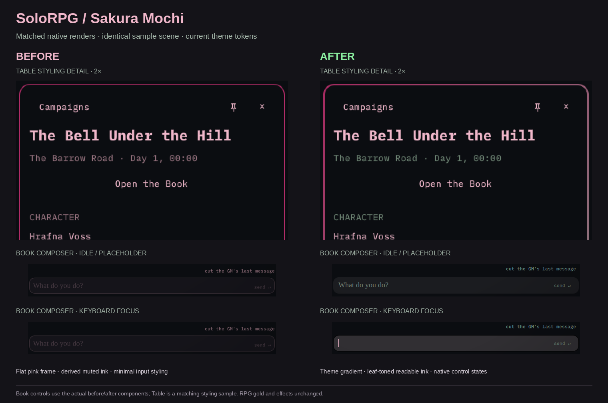

# Theme-integration comparison

`sakura-mochi-before-after.png` is a matched before/after comparison rendered locally with the same Sakura Mochi palette, shell tokens, fonts, window dimensions and example campaign state.

- The Book crops use the actual before/after Book components, in idle and keyboard-focus states.
- The Table crop is a matching styling sample illustrating the border and text roles, not a screenshot of a different Table layout feature.
- The sample comes from `tests/qml/scenario.py`: this project's own **The Bell Under the Hill** adventure and the bundled CC BY 4.0 Ironsworn material credited in `NOTICE.md`. It contains no private campaign data or content extracted from a purchased book.
- Fixed RPG gold, border-flash colors and screen effects are unchanged.

